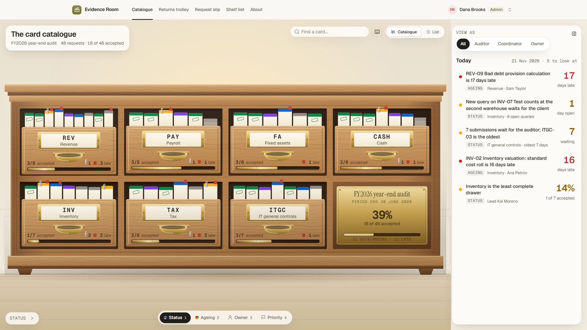

# Evidence Room

A shared request room for a year-end audit. Auditors post "provided by client" (PBC) requests, owners add evidence and
answer queries, and both sides see status, due dates and what is really outstanding by audit area. The home screen is
a wooden card catalogue: one drawer per audit area, one index card per request, filling as evidence is accepted.




## This repository

```text
apps/evidence-room/   the app: React + Vite frontend, Rayfin data model (rayfin/), tests, demo walkthrough
shared/         shared package (@x10/shared): data store, sign-in runtime, UI kit, charts
tools/          deploy, seed, SQL and secrets-check scripts
```

Quick start (no Fabric tenant needed, runs in demo mode with sample data):

```bash
npm install
npm run dev
```

## The problem

Every year-end audit starts with a PBC list: hundreds of requests for schedules, reconciliations and samples. It is
usually a spreadsheet passed between auditor and client. Deadlines slip, the same document is sent twice, queries get
lost in email, and nobody knows what is actually outstanding.

Evidence Room supports the evidence and documentation work in **ISA 500 (Audit Evidence)** and **ISA 230 (Audit
Documentation)**: who asked for what, what was provided when and by whom, which queries were raised and answered, and
what was accepted. ISA 230 (A21) notes that the final audit file is ordinarily assembled within **60 days** of the
auditor's report, which is easier when the request trail is already in one place. The app supports the process; it is
not audit, accounting, legal or compliance advice, and it never judges whether evidence is sufficient or appropriate.

## What it looks like

**The card catalogue.** A wooden cabinet with one drawer per audit area and a brass engagement plaque. Every drawer
stands a little ajar, so the top of each request card shows above its front, coloured by the lens; **overdue cards
stick up with a red tab**, **cards with an open query wear a paper clip**, **accepted cards are stamped**. Each front
carries a brass label holder (area code and name), a cup pull, counts, and a **brass strip filled to the area's
progress**. Opening a drawer slides it out of its slot into a tray where the cards stand in order; picking a card
lifts it out so its face (detail, owner, due date, evidence count, state) can be read.

- **Lenses** (keys 1–4): status, ageing (not due, 1–7, 8–14, 15+ days late), owner, priority.
- **View as** (V): all, auditor (submissions waiting for review stay lit), coordinator (everything still with the
  client stays lit), owner (your own cards). Each seat starts in its own view.
- **Today:** three to five ranked items: overdue high-priority requests, open queries waiting for the client (a new
  query first for the coordinator), submissions waiting for the auditor, and the area with the lowest progress. Each
  opens the drawer behind it, lifts the card and switches to its lens.
- **Tools:** **Request slip** (auditors write requests; similar existing requests appear as the title is typed),
  **Reading desk** (one request: evidence by version, thread, the actions your seat allows), **Returns trolley**
  (submitted evidence waiting for an auditor, oldest first, to accept or query), **Shelf list** (the weekly meeting
  report by area, CSV and print).
- **Fallbacks:** the catalogue is SVG (no WebGL needed, so `?nowebgl` shows the same scene); **L** switches to an
  accessible, filterable table of the same 48 requests; reduced motion removes the drawer slide, card lift, stamp and
  clip animations; arrows open drawers and lift cards; `?` lists the shortcuts; the shelf list prints as a document.
  Screens for every page, both themes, desktop and phone: [docs/redesign](apps/evidence-room/docs/redesign).

## Prerequisites

- A Fabric tenant with the **Fabric Apps** workload enabled.
- A workspace on a Fabric capacity, and **Edit** (Contributor or higher) permission on it to deploy.
- Node.js 20 or later.
- Users need access to the app item (workspace members get it by default). **External auditors join as guests** in
  your tenant (Microsoft Entra B2B) and are given access to the app item; deployed apps accept Fabric SSO only.
- SQL-only app, authenticated access only (no anonymous data access, no connector).

## Run locally

```bash
npm install            # once, at the repository root
cd apps/evidence-room
npm run dev            # offline demo on http://localhost:5219 with seed data and a persona switcher
npm run dev:fabric     # rayfin dev: the real Rayfin backend and Fabric sign-in
npx tsc -b && npx vitest run && npx playwright test
SCREENSHOTS=1 npx playwright test e2e/screenshots.spec.ts   # rewrite docs/redesign/*.png
```

Demo personas (identity menu, or open with `?as=<sub>`):

| Persona | Sub | Seat |
|---|---|---|
| Dana Brooks | `demo-coord-dana` | Client coordinator (admin): assigns owners, can provide evidence on any request |
| Morgan Hale | `demo-auditor-morgan` | Lead auditor: writes slips, queries, accepts, withdraws |
| Riley Chen | `demo-auditor-riley` | Auditor |
| Sam Taylor | `demo-owner-sam` | Owner (revenue and cash requests) |
| Priya Nair | `demo-owner-priya` | Owner (payroll requests) |

## Deploy

```bash
npx rayfin login
npx rayfin up --workspace-id <workspace-id>
```

`rayfin up` builds the app (`build:fabric`), deploys it and applies the schema.

## Seed and admins

```bash
npm run seed:fabric -- --admin-email you@org.com
```

Inserts one engagement, "FY2026 year-end audit", in fieldwork, with 7 areas (Revenue, Payroll, Fixed assets, Cash,
Inventory, Tax, IT general controls), 10 members (4 auditors, 6 client people), **48 requests** (18 accepted, 7
submitted, 6 query, 8 in progress, 7 open, 2 withdrawn; of the 21 still with the client, 10 are not due, 5 are 1–7
days late, 3 are 8–14 and 3 are 15+), 59 evidence entries and 41 thread messages. Dates are relative to the moment you
seed. Skipped when the `seed:v1` marker exists. The script maps the first persona (Dana, the coordinator) to your
account and sets you as admin; open the app once first so your Person row exists. By hand:

```sql
UPDATE dbo.People SET isAdmin = 1 WHERE email = 'you@org.com';
```

**Members** decide who is an auditor. They are read-only through the API (so nobody can make themselves an auditor),
so add real people with SQL once they have opened the app (their `sub` is on their `People` row):

```sql
INSERT INTO dbo.Members (engagementId, personSub, personName, side, role)
SELECT e.id, p.sub, p.displayName, 'auditor', 'member'
FROM dbo.Engagements e CROSS JOIN dbo.People p
WHERE e.name = 'FY2026 year-end audit' AND p.email = 'auditor@guest.example';
```

Use `side = 'client'` with `role = 'member'` for owners, or `role = 'coordinator'` for coordinators. Engagements and
audit areas (`dbo.Engagements`, `dbo.AuditAreas`) are set up the same way.

## How it works

### Entities

| Entity | Purpose | Key fields |
|---|---|---|
| `Engagement` | The audit (the room) | name (3–120), periodEnd, fieldworkStart, fieldworkEnd, status (`planning`, `fieldwork`, `completion`, `closed`) |
| `AuditArea` | One drawer | engagementId, name (3–60), code (2–6, prefixes refs: `REV-07`), position, leadAuditorName (≤100) |
| `Member` | Who sits where | engagementId, personSub, personName (≤100), side (`auditor`, `client`), role (`lead`, `member`, `coordinator`) |
| `EvidenceRequest` | One PBC request (a card) | engagementId, areaId, ref (≤12), title (3–150), detail (≤1500), ownerSub/ownerName?, dueAt, priority (`normal`, `high`), status (`open`, `in_progress`, `submitted`, `query`, `accepted`, `withdrawn`), createdBy, submittedAt?, acceptedAt?, acceptedBy? |
| `Evidence` | Append-only evidence | requestId, kind (`file`, `link`, `note`), title (≤200), location (≤500: file name and folder, or link), note (≤1000)?, addedBy, addedAt, version |
| `Thread` | Queries, replies, notes, withdrawal reasons | requestId, bySub, byName, side, kind (`message`, `query`, `withdrawal`), body (≤1500), at |
| `Person`, `AppMarker` | Shared identity and seed marker | as generated |

`AuditArea.code`/`position` and `Thread.kind` are additions to the spec's fields (ref prefixes, drawer order, and
telling a query from a reply).

### Rules (pure and unit-tested in `src/domain/rules.ts` and `catalogue.ts`; thresholds in `src/config.ts`)

1. Only auditors write requests, raise queries, accept and withdraw. Only the request's owner or a client coordinator
   adds evidence and submits; only coordinators assign owners (`permissionBlocker`).
2. Status machine (`transition`): open → in progress (owner assigned **and** first evidence) → submitted → query
   (auditor asks, with a question of at least 10 characters) → submitted → accepted. Withdrawn by auditors only, with
   a reason of at least 10 characters posted to the thread. Accepted and withdrawn are final.
3. Overdue: not submitted or accepted (open, in progress or query) after `dueAt`. Days late are whole days past the
   due time, rounded up. Ageing buckets: not due, 1–7, 8–14, 15+ days late.
4. Duplicate hint: Dice word-overlap of titles (lowercase, small words dropped, light plural stemming) against open or
   accepted requests in the engagement; shown at 45% or more, up to 3. "bank reconciliation" finds CASH-01.
5. Progress per area = accepted ÷ (all − withdrawn).
6. Evidence is never edited: each query starts a new version (round), so the auditor sees what changed after asking.
7. Integrity: `integrityIssues` flags requests written or accepted by someone who is not an auditor member, and stamps
   without dates. The shelf list and the reading desk show them.

### Security model

| Entity | read | create | update | delete |
|---|---|---|---|---|
| Engagement, AuditArea, Member | everyone signed in | nobody (SQL / seed tool) | nobody | nobody |
| EvidenceRequest | everyone signed in | `createdBy = claims.sub` **and** `status = 'open'`; owner, submittedAt, acceptedAt, acceptedBy excluded | only while `status` is open, in progress, submitted or query; engagementId, areaId, ref, title, detail, dueAt, priority, createdBy excluded (frozen) | nobody |
| Evidence | everyone signed in | `addedBy = claims.sub` | nobody | nobody |
| Thread | everyone signed in | `bySub = claims.sub` | nobody | nobody |
| Person / AppMarker | as generated (isAdmin never writable from the client) | | | |

Enforced **by the database**: the member list (and so who is an auditor) cannot be changed from the app; you can only
write requests, evidence and messages as yourself; what an auditor asked for is frozen after create; accepted and
withdrawn requests cannot change; evidence and messages cannot be edited or deleted.

Enforced **in the domain** (`src/domain/room.ts`, both demo and Fabric mode), because the policy DSL cannot look up
`Member.side`: auditor-only actions, owner-or-coordinator evidence and submission, coordinator-only assignment, the
status machine, ref uniqueness, and the length rules. `src/domain/policies.ts` mirrors the row policies and the demo
store refuses the same writes.

## Known limits

- **Seat checks are app-enforced.** Through the GraphQL API, bypassing the app, any signed-in user could create a
  request as themselves (status open), add evidence or messages as themselves, or change the owner and status fields
  of a live request (for example mark it accepted with themselves as `acceptedBy`). They cannot touch what was asked,
  forge someone else's name, or reopen an accepted or withdrawn request. The app flags such rows (not written or
  accepted by an auditor member, stamps without dates) on the shelf list and the reading desk: detected, not
  prevented.
- **Files: no direct upload.** Rayfin Storage (OneLake-backed folders) exists in the Rayfin guide, but it needs the
  `@microsoft/rayfin-storage` package and `rayfin storage init`, which are not installed in this scaffold, and it has
  no local emulator. Evidence therefore records a link, a file name with its folder, or a note. Nothing pretends to
  upload.
- One engagement at a time: the app shows the one in fieldwork (or completion), else the latest by period end.
- Members, areas and engagements are managed with SQL (see Seed and admins).
- Live screens poll every 5 seconds; there are no push updates.

## Later

- Direct evidence upload with Rayfin Storage (`rayfin storage init`, an owner-scoped folder per request).
- Dynamic auth claims so the database enforces auditor-only actions.
- Auditor sample selection (pick the 25 invoices for a sample request inside the app).
- Rollforward: copy this year's requests into next year's engagement.
- A setup screen for engagements, areas and members (needs an admin claim to stay secure).
- Email or Teams nudges for overdue requests and new queries.

## Gallery

**Title:** Birthday Bash: Evidence Room

**Blurb (≤80 words):** The audit PBC list as a shared room: every request, its evidence, its queries, and what is
really outstanding. Requests are index cards in a wooden catalogue, one drawer per audit area; overdue cards stick up
with a red tab, open queries wear a paper clip, accepted cards are stamped and a brass strip fills as each area
completes. Auditors write slips with duplicate hints, owners answer at the reading desk, and the shelf list is the
weekly meeting pack.

**Tags:** Partner | Birthday Bash, Fabric Apps, Audit, Finance, Year-end close, Governance

## License

MIT. See [LICENSE](LICENSE).
